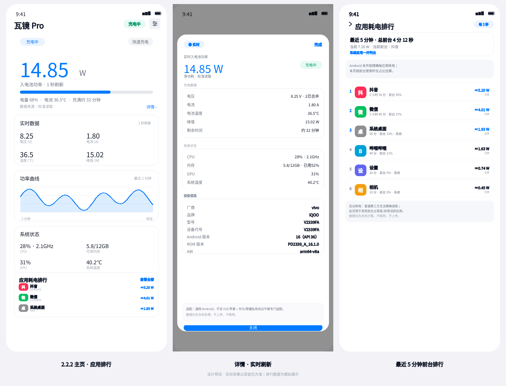
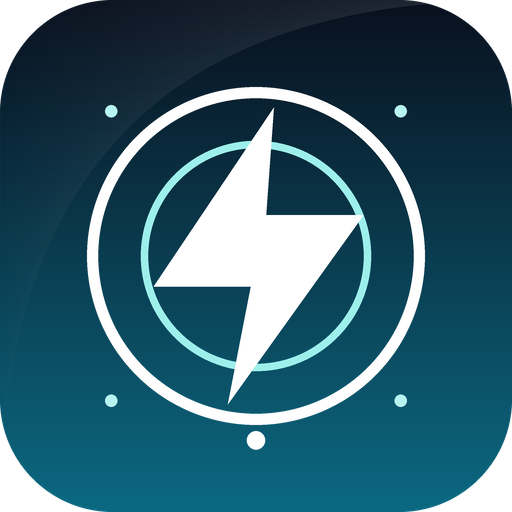

# 瓦镜 Pro · WattLens Pro

> 前身「充电功率 Pro / ChargeMeter Pro」；2.0.0 起更名为 **瓦镜 Pro**，包名仍为 `com.dsh.powermeter`。

按《安卓充电功率与实时功耗显示 PRD V1.4》实现的一个干净、无广告、无联网的 Android 实时充电功率监视器（Pro 版）。

核心目标：显示**真正进入电池的功率**，而不是充电器协议协商的峰值；功率算法对齐 [ChargeMeter](https://github.com/123xxss/ChargeMeter)，并对 vivo / OPPO / 小米的电芯数、单位、越界读数做可解释处理。

> [下载 APK v2.2.2](https://github.com/123xxss/ChargeMeter-Pro/releases/download/v2.2.2/WattLens-Pro-v2.2.2.apk) · [GitHub 仓库](https://github.com/123xxss/ChargeMeter-Pro) · [详细项目报告](docs/PROJECT-REPORT.md)





**详细项目报告（功能 / 更新 / Bug 修复 / 架构 / 测试）：[docs/PROJECT-REPORT.md](docs/PROJECT-REPORT.md)**

## 2.2.2 更新（统一检查与汇总换行）

- 修复排行页顶部汇总“最近 5 分钟 · 总前台 3 分钟 · 当前 7.26…”被单行截断：改为 17.5sp、最多 3 行，完整显示时长/功率/当前前台。
- 统一检查主界面 Top3、完整排行、详情、系统状态、通知和设置的长文本/空值/权限状态；保留“估算”标注，不伪造精确耗电。
- 排行仍只取最近 5 分钟 UsageEvents，主界面 3 秒、完整页 2 秒刷新。
- 版本 24 / 2.2.2；测试 312 项通过。

## 2.2.1 更新（排行改为最近 5 分钟前台）

- 修复应用排行把“很久以前打开过、当前早已不在前台”的软件列出来的问题。
- 排行改用 Android `UsageEvents`，只统计**最近 5 分钟**真正进入前台的应用，避免 24 小时聚合数据污染。
- 打开瓦镜自身时结束上一个应用的前台区间，不把已经离开的应用继续算进去。
- 每 2 秒重新查询事件；主界面 Top 3 每 3 秒刷新。
- 仍明确标注：普通 Android 无法精确读取 BatteryStats，耗电是前台时长占比估算；后台真实耗电无法读取。
- 版本 23 / 2.2.1；测试 312 项通过。

## 2.2.0 更新（主界面内嵌应用排行）

- 主界面直接显示 **应用耗电排行 Top 3**：应用图标、名称、估算功率/前台占比；每 3 秒刷新。
- 点「查看全部」进入完整排行页（每 2 秒刷新，前 30 名，含系统应用）。
- 无「使用情况访问」权限时，主界面卡片显示授权提示；授权后自动出现 Top 3。
- **边界说明**：普通 Android 无法精确读取每应用 BatteryStats；排行是前台时长 + 电池功率的估算，页面会标注。Shizuku 负责系统状态（CPU/GPU/温度）读取，不伪造系统精确耗电。
- 版本 22 / 2.2.0；测试 312 项通过。

## 2.1.0 更新（应用耗电排行 + 实时刷新）

- 新增 **应用耗电排行**：主页入口 → 独立页面，列出应用/系统应用的前台使用时长、前台占比和按当前电池功率估算的耗电。
- **每 2 秒自动刷新**，含应用图标、系统应用标记、前 30 名。
- 可选 **使用情况访问** 权限：只读取前台使用时长，不读聊天内容、不联网；未授权时页面会引导授权。
- **重要边界**：Android 不向普通第三方开放精确的每应用 BatteryStats；排行是“前台时长 + 电池功率占比”的估算，不代表系统后台真实耗电，页面会明确标注。
- 无充电器时也能打开排行；用于发现前台占用高/异常活跃应用。
- 版本 21 / 2.1.0；测试 312 项通过。

## 2.0.0 更新（瓦镜 Pro · 新图标 + 图表/系统状态优化）

- 应用更名 **瓦镜 Pro（WattLens Pro）**，新图标：镜头环 + 闪电 + 深青渐变。
- 功率曲线重做空态：无数据时不再出现黑色网格和文字叠压，改为柔和占位；有数据时使用平滑曲线、虚线网格、当前值。
- 系统状态排版优化：数值只放短指标（如 `19%`），频率/核心数/已用比例放到标签，避免 `19% · 0.30G…` 截断；GPU/温度未开放单独标注。
- 实时数据：无充电会话时峰值显示 `--`，不再出现误导性的 `0.00 W`。
- 新增文字防溢出：顶栏胶囊、指标标签、系统提示、会话标题、详情行统一限制宽度/行数并省略；动画只改变透明度和位移，不改变宽度。
- 动效扩展到 5 档：标准 / 增强 / 关闭 / vivo 原子 / Apple 流畅。
- 通知栏每帧与主界面同步；详情页实心圆角底板、无“详情”大标题。
- 版本 20 / 2.0.0；测试 312 项通过。

## 1.9.1 更新（详情圆角底板 + 动效选项 + 通知同步）

- **详情弹窗修复**：增加整张实心圆角底板，阻断底层主页内容透出；删除顶部“详情”大标题，只保留“实时”状态和“完成”。
- **文字防溢出**：详情行、设备信息、系统状态提示统一限制宽度/行数并省略；数值动画只改透明度，不撑破布局。
- **可带动效**：设置 → 显示与通知 → **动效**（标准 / 增强 / 关闭），控制主页入场、设置入场、详情分组动画、数值淡入。
- **通知栏同步**：服务在处理每一帧快照时都刷新通知，不再因文本去重导致比主界面慢一拍。
- **主页预览图**已放到 README 顶部，GitHub 首页可见。
- 版本 19 / 1.9.1；测试 312 项通过。

## 1.9.0 更新（主页 + 详情页 UI 重做）

- 主页重做：顶栏状态胶囊、实时数据统一 2×2 大卡、系统状态卡、会话卡统一间距与层级。
- 详情页重做：顶部实时功率大卡 + 「充电数据 / 系统状态 / 设备信息」分组卡片，替代原来的一长串平铺行。
- 动画重做：主界面错峰入场、设置二级页入场、详情分组逐段淡入、数值变化轻微淡入、弹窗缩放淡入。
- 保留 5 种风格；详情弹窗固定 80% 高度 + 完整滚动。
- 版本 18 / 1.9.0；测试 312 项通过。

## 1.8.0 更新（五风格 + 全 App 动画 + 设备信息）

- 新增两种风格：**薄荷清透、紫色星云**；现在共 5 种：Apple 极简 / 经典渐变 / 深色霓虹 / 薄荷 / 紫色星云。
- 全 App 动画优化：页面进入/退出淡入滑动、主界面卡片错峰入场、设置二级页入场、详情弹窗缩放淡入；修复弹窗尺寸跳变导致的内容显示不完整。
- 详情页新增设备信息：厂商、品牌、型号、设备代号、Android 版本、ROM 版本、ABI。
- CPU/GPU/系统温度不可读时，可通过 Shizuku 只读 `readSystem()` 读取；主界面与详情页都有入口。
- 保留详情弹窗固定视口 + ScrollView，关闭按钮和说明均可滚动看到。
- 适配说明：通用 Android，不含 iOS/苹果；华为/荣耀私有快充不做专门适配，可用功率校准修正。
- 版本 17 / 1.8.0；测试 312 项通过。

## 1.7.2 更新（CPU 兜底 + 详情滚动）

- CPU 使用率直接读取 `/proc/stat` 失败时，也可通过 Shizuku 只读 UserService 兜底。
- 详情弹窗固定 78% 屏幕高度 + ScrollView，关闭按钮/说明可完整滚动（1.7.1 修复）。
- GPU/温度/CPU 任一不可用时，主界面和详情页显示「用 Shizuku 尝试读取」入口。
- 版本 16 / 1.7.2；测试 312 项通过。

## 1.7.1 更新（详情滚动 + Shizuku 提示）

- 修复充电详情弹窗高度超过屏幕、内容顶部/底部被裁切、内部无法完整滚动的问题。
- 详情弹窗改为固定视口 + 完整 ScrollView，关闭按钮和说明文字都能滚动到。
- GPU/系统温度显示“系统未开放”时，主界面与详情页新增 **「用 Shizuku 尝试读取」** 入口：
  - 未安装 Shizuku → 提示先安装并启动；
  - 未授权 → 请求 Shizuku 授权；
  - 已授权 → 打开只读增强并重新读取。
- Shizuku UserService 新增只读 `readSystem()`，可尝试读取 thermal/GPU sysfs；仍读不到则保持 `--`，不伪造数据。
- 版本 15 / 1.7.1；测试 312 项通过。

## 1.7.0 更新（系统状态 + Apple UI + 实时详情）

- 新增**系统状态卡**：CPU 使用率/频率/核心数、可用内存、GPU 使用率、系统最高温度；详情页补充存储剩余。
- 数据全部只读：CPU 来自 `/proc/stat`，内存来自 `MemoryInfo`，GPU/温度尝试标准 sysfs；系统不开放时显示 `--/系统未开放`，不伪造。
- **详情弹窗实时刷新**：打开后每秒随主界面更新功率、电压、电流、系统状态等，不再是一次性快照。
- 新增**界面风格**：Apple 极简（默认）、经典渐变、深色霓虹；功率卡、曲线同步切换。
- 长按功率卡复制当前功率；曲线支持铺满/当前值显示、新会话清空。
- 版本 14 / 1.7.0；测试 312 项通过。

## 1.6.0 更新（UI 与细节优化）

- 功率曲线优化：曲线铺满宽度、显示「-2 分钟 / 现在」与当前值；新充电会话自动清空旧曲线。
- 充电动画优化：应用不可见/切后台时停止动画，避免无意义耗电；可见时恢复。
- 长按功率卡可复制当前功率，方便对比测试。
- 通知栏功率统一为两位小数，与主界面一致。
- 清理旧卡片遗留字段与已废弃的双电芯设置代码，降低维护风险。
- 版本 13 / 1.6.0；测试 312 项通过。

## 1.5.2 更新（关于页作者/仓库）

- 设置 → 关于页新增：作者 `123xxss`、开源仓库地址，以及「打开 GitHub 仓库」按钮。
- 版本 12 / 1.5.2；测试 312 项通过。

## 1.5.1 更新（设置清理 + 兜底修复）

- 移除与「电芯数」重复的「双电芯修正」设置：现在只保留一处口径，避免两个开关互相覆盖。
- 电芯数 = 品牌推荐（vivo/OPPO/小米/荣耀 2，其余 1）或用户手动 1–4。
- Shizuku / 增强读取在标准 BatteryManager 电压/电流不可用时，作为参考算法的只读兜底，并标注数据来源。
- 新增参考算法回归测试（用户截图数据 3.95V/1.88A/2 芯 = 14.85W）。
- 版本 11 / 1.5.1；测试 312 项通过。

## 1.5.0 更新（完全采用 ChargeMeter 功率算法）

- 主功率直接采用 ChargeMeter 的算法：
  `P = |CURRENT_NOW(µA)/1e6| × EXTRA_VOLTAGE(V) × 电芯数 × 校准倍率`
- 电芯数按品牌推荐（vivo/OPPO/小米/荣耀默认 2，其余 1），设置中可改为 1–4；不再依赖高电流自动探测。
- `EXTRA_VOLTAGE` 只接受 2500–5000mV，超出按参考项目视为不可用；功率 >400W 时按 mA 再解释一次单位。
- 主功率不做额外平滑，按 1 秒采样直接显示；曲线/峰值/摘要同样使用该算法。
- 保留两位小数、功率校准、2 分钟曲线、充电动画、Shizuku 增强。

## 1.4.1 更新（刷新频率）

- 充电功率改为 **1 秒刷新一次**；不再在波动时提频到 0.25 秒。
- 功率曲线按 1 秒采样，保留最近 2 分钟（120 点）。
- 其余口径与 1.4.0 一致。

## 1.4.0 更新（参照 ChargeMeter 的功率显示）

- 功率计算与显示对齐 ChargeMeter 的已验证口径：`P = |I| × V × 电芯数 × 校准倍率`。
- vivo / OPPO / 小米双电芯品牌**默认按 2 电芯计算**，不再要求电流 ≥5A；单电芯异常机型可在设置里关闭双电芯修正。
- 主功率改为**两位小数**；新增**最近 2 分钟实时功率曲线**（0.5 秒采样）。
- 新增**功率校准**：输入系统/功率计显示的功率，反推本机倍率。
- 保留 1 秒刷新、充电动画、Shizuku 只读增强。

## 1.3.1 更新（实时刷新）

- 充电采样从 1 秒提升到 **0.5 秒/次**；功率剧烈波动时临时 **0.25 秒/次**。
- 主界面自绘卡片、通知栏、详情弹窗共用同一帧数据，同步刷新。
- 电量/温度/预估等辅助数据仍按原逻辑刷新；锁屏通知随充电状态更新。

## 1.3.0 更新（双电芯自动修正）

- 自动双电芯判定新增三层判据：
  1. 已知双电芯机型表（vivo/iQOO V23 系列、iQOO 12/Neo 系列、X90/X100，OPPO/一加/realme 与小米部分高功率型号）；
  2. Shizuku / 增强读取可读时，使用 `voltage_max`（电池最大电压）判定，2S 通常 ≥7V；
  3. 原有 `POWER_MAX ≥50W` 与高电流兜底。
- 对应机型（如 V2339FA / iQOO Neo9S Pro）即使低功率充电也会按 2S 修正，不再依赖“必须 ≥5A”才触发。
- 仍保留设置 → 双电芯修正的手动“自动/强制/关闭”，详情页显示电芯数与修正状态。

## 1.2.0 更新（Shizuku + 自绘功率卡 + 动画）

- 新增 **Shizuku 只读增强读取（实验性，默认关闭）**：设置 → 数据口径 → 授权后通过 UserService 读取标准 sysfs 电池节点；未安装/未授权/断连自动回退标准路径，不执行 shell、不写文件。
- 主充电卡片改为 **自绘紧凑卡（236dp）**：功率、状态、档位、进度、温度/预估、数据来源全部由 Canvas 绘制，避免 OEM 布局测量导致内容缺失/卡片拉满。
- 新增**充电动画**：充电中进度条流光 + 呼吸闪电；不充电时停止动画。
- 详情弹窗继续展示数据来源（标准/Shizuku 增强）。

## 1.1.2 布局修复

- 充电主卡片固定为 340dp 紧凑高度并顶部对齐，不再被某些 ROM 的 `ScrollView`/权重测量拉满整屏。
- 关闭 `fillViewport`，避免内容高度被视口二次拉伸。

## 1.1.1 修复（重要）

- **修复 Android 16（SDK 36）首次打开闪退**：`UiKit.styleSystemBars` 在 `setContentView` 之前调用 `Window.getInsetsController()`，此时 `DecorView` 还没创建，`PhoneWindow.getInsetsController()` 抛出 `NullPointerException`。
- 修复方式：主界面/设置页都改为**先构建内容（setContentView）再设置系统栏**；`styleSystemBars` 增加 `DecorView` 判空与异常兜底。
- 1.1.0 的其他改动保留：Pro 名称、新图标、`startService` 启动链路、最小前台通知、安全模式、本地崩溃记录。

## 1.1.0 更新（Android 16 启动兼容）

- 应用更名「充电功率 Pro」，全新渐变+闪电自适应图标。
- 启动链路加固：从可见界面改用 `startService` 启动监测，避免前台服务被 OEM 拒绝时触发系统级 `did not call startForeground` 闪退。
- 前台通知先使用最小字段进入前台，再换成完整卡片，降低 OEM 通知构建差异导致的启动失败。
- 主界面构建/刷新异常时进入「安全模式」而不是闪退；下次启动可查看并一键复制上次崩溃堆栈（仅本地文件）。
- 仍无网络权限、无上传。

## UI 与功能一览

- **主页**：顶栏状态胶囊；实时入电池功率大卡（两位小数、1 秒刷新、进度条、温度/预估/来源）；2×2 实时数据卡；2 分钟功率曲线；CPU/内存/GPU/系统温度系统状态卡；本次充电摘要。
- **详情页**：顶部大号实时功率卡；充电数据 / 系统状态 / 设备信息三组卡片；每秒跟随主界面刷新；厂商、品牌、型号、Android、ROM、ABI。
- **通知栏/锁屏**：充电功率、档位、电量、温度、预计充满；低优先级静默，锁屏可见。
- **风格**：Apple 极简、经典渐变、深色霓虹、薄荷清透、紫色星云。
- **动效**：标准 / 增强 / 关闭三档，可独立控制入场、分组、数值、弹窗动画。
- **数据口径**：ChargeMeter 兼容的 `P = |I| × V × 电芯数 × 校准倍率`；电芯数品牌推荐 + 手动覆盖；功率校准；2 分钟曲线。
- **系统状态**：CPU 使用率/频率、可用内存、GPU、系统温度、存储；不可读时可用 Shizuku 只读兜底。
- **应用耗电排行**：主界面 Top 3（3 秒）+ 完整页前 30（2 秒）；可选使用情况访问；按前台时长和电池功率估算，含系统应用。
- **应用排行限制**：普通 Android 应用无法读取精确每应用 BatteryStats，排行是估算，不是系统后台耗电账单。
- **隐私**：无 INTERNET、无广告、数据仅本机处理；使用情况访问是可选特殊权限，只读前台时长。

## 功能

- **实时入电池功率**：`P = |I| × V × 电芯数 × 校准倍率`（对齐 ChargeMeter），两位小数，1 秒刷新。
- **档位判定**：普通充电（<5W）/ 快速充电（5–30W）/ 超级快充（≥30W）；异常降速优先显示橙色提示。
- **状态覆盖**：未充电、充电中、已暂停、已充满、异常降速、读数不可用、净功耗接近零。
- **通知栏 / 锁屏卡片**：常驻低优先级通知，充电时显示 `23.4 W · 超级快充`、电量、温度、预估时间；未充电时不显示功率数字。
- **详情弹窗**：电压、电流、温度、平滑峰值、剩余时间、充电模式、数据来源、电芯数与修正说明，并固定展示口径说明。
- **实时功耗检测（子开关，默认关）**：充电中显示净功率绝对值，接近零时显示「接近零」，放电时显示「放电功耗」。
- **电芯数**：按参考 ChargeMeter 的品牌推荐值（vivo/OPPO/小米/荣耀 2，其余 1），也可手动改 1–4；没有第二套自动探测。
- **充电预估**：不使用 `computeChargeTimeRemaining()`，按当前功率 + 电池容量 + CC/CV 两阶段修正自研估算，统一标注「估算」。
- **实时功率曲线**：最近 2 分钟、1 秒采样、120 点。
- **系统状态**：CPU 使用率/频率、可用内存、GPU 使用率、系统最高温度，详情页含存储剩余。
- **五种界面风格**：Apple 极简 / 经典渐变 / 深色霓虹 / 薄荷清透 / 紫色星云。
- **功率校准**：输入系统/功率计读数反推本机倍率。
- **本次充电摘要**：仅记录本次/上次的平滑峰值、平均功率、时长、起止电量，本地保存，不做长期历史。
- **后台白名单引导**：首次使用按 vivo / OPPO / 小米弹对应设置说明，并尝试品牌深链跳转，失败自动回退系统页面。
- **只读增强读取（实验性，默认关）**：可选读取标准 sysfs 电池节点（`/sys/class/power_supply/battery`、`bms`），只读、无额外权限；读不到自动回退标准路径。

## 不做的（明确边界）

- **AOD**：普通第三方应用没有系统签名/厂商 AOD 接口，不提供无效入口。
- **系统状态栏原生嵌入**：仅通知形式；不承诺把数字嵌入系统电池图标。
- **Shizuku 深度读取**：已接入只读增强路径（默认关闭，实验性）。只读取标准 sysfs 白名单节点；未授权、断连、服务被杀时一个刷新周期内回退标准路径。仍需按机型验证权限与节点可用性。
- **充电器输入功率 / VBUS**：普通应用读不到。详情页不展示「实时充电器输入功率」，避免 OPPO 等机型虚假数据。
- 不做第三方协议破解、跨设备同步、长期曲线、应用级功耗拆分。

## 数据口径（重要）

```
入电池功率 = 归一化整包电压(V) × 归一化电流(A)
```

- **锁屏卡片**：第三方应用无法在原生锁屏/充电动画位置绘制卡片，本版用高可见度常驻通知承载「锁屏可读的充电卡片」；这是 Android 权限模型下的可行形态。
- **状态栏**：通知形式展示 `XX W`，不是系统电池图标内嵌。
- **边充边用**：显示的是进入电池的功率，不是充电器输出；高负载时可能明显偏低，详情弹窗有固定说明。
- **双电芯**：系统可能只上报单电芯电压（约 3.8–4.5V）。自动模式按品牌/功率/电流启发式修正；个别单电芯高功率机型可能被误判，可在设置里改为「关闭修正」。
- **电流符号**：不硬编码正负，以充电状态为基准自动反转；vivo sysfs 负电流场景已覆盖。
- **电流单位**：标准为 µA；极少数 ROM 上报 mA，核心层按功率合理性识别并记忆。
- **增强读取**：sysfs 节点在普通应用 UID 下经常被 SELinux 禁止，读不到时完全回退标准 BatteryManager，不影响核心功能。

## 权限与隐私

仅申请：

- `FOREGROUND_SERVICE` / `FOREGROUND_SERVICE_SPECIAL_USE`：常驻低优先级通知 + 实时刷新；
- `POST_NOTIFICATIONS`：通知栏/锁屏卡片；
- `RECEIVE_BOOT_COMPLETED`：重启后恢复监测；
- `moe.shizuku.manager.permission.API_V23`：Shizuku 客户端授权（仅用户手动开启增强读取时使用）。

**没有** `INTERNET`、定位、存储、通讯录、电话状态、`BATTERY_STATS`、悬浮窗权限。所有数据只在本机处理，不上传、不同步、不生成用户画像；日志不打印原始电流/电压时间序列。

## 构建

无需 Gradle，直接 aapt2 + javac + d8 + apksigner 出包（与 CI 一致的轻量方式）：

```bash
# 依赖：JDK 17+、Android build-tools、android.jar
# 默认路径 /root/android/sdk/android-14 与 /root/android/sdk/android-36
cd powermeter
bash build.sh
# 输出：powermeter.apk
```

可用环境变量：`ANDROID_SDK_ROOT`、`BUILD_TOOLS_DIR`、`ANDROID_JAR`、`QEMU`、`VERSION_CODE`、`VERSION_NAME`。

ARM 主机（手机 proot）上会自动用 `qemu-x86_64-static` 运行 x86_64 的 aapt2/zipalign。

构建前会先跑 `tests/run_tests.sh`（纯 JVM 单测），测试失败不会继续出包。

安装：

```bash
adb install -r powermeter.apk
# 国产 ROM 安装未备案应用需手动确认，属正常现象
```

## 测试

```bash
bash tests/run_tests.sh
```

当前结果：**301 项全部通过**（核心算法单测 286 项 + 安全/PRD 静态扫描 15 项）。测试运行时 classpath 不含 android.jar，证明核心算法不依赖 Android 运行时。覆盖符号归一化、双电芯 67W / 18W、mA 单位识别、越界过滤、平滑与平滑峰值、充满预估、会话摘要、异常检测，以及清单/危险 API 静态检查。

详见 [测试报告](docs/TEST-REPORT.md)、[PRD 合规对照](docs/PRD-COMPLIANCE.md)、[真机验收清单](docs/DEVICE-CHECKLIST.md)。

## 目录

```
src/com/dsh/powermeter/
  core/        采样、归一化、平滑、峰值、预估、状态机、快照（纯 JVM 可测）
  service/     前台服务、通知栏卡片、插拔/开机接收器
  ui/          界面辅助与详情弹窗
  MainActivity.java / SettingsActivity.java
  Prefs.java / BrandCompat.java / App.java
tests/         核心算法单元测试与安全检查
res/           颜色（含 values-night）、主题、图标
build.sh       无 Gradle 构建脚本
docs/          PRD 合规对照、测试报告
```

## 已知限制

- 锁屏卡片是通知形态，是否显示在锁屏取决于系统通知设置；部分 ROM 会折叠常驻通知。
- Android 12+ 从后台启动前台服务受系统限制；服务在首次打开 App / 开机后常驻，插电时通常已运行；若被系统杀掉，插电自动拉起可能失败，需要打开一次 App。
- OPPO/vivo/小米的后台清理策略仍可能冻结刷新，需按引导设置白名单。
- 双电芯自动判定是启发式，极端机型请用设置里的手动修正。
- 个别 ROM 的电流单位/符号不标准；核心层已做常见兜底，但无法覆盖所有私有实现。

## License

MIT
